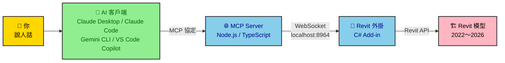
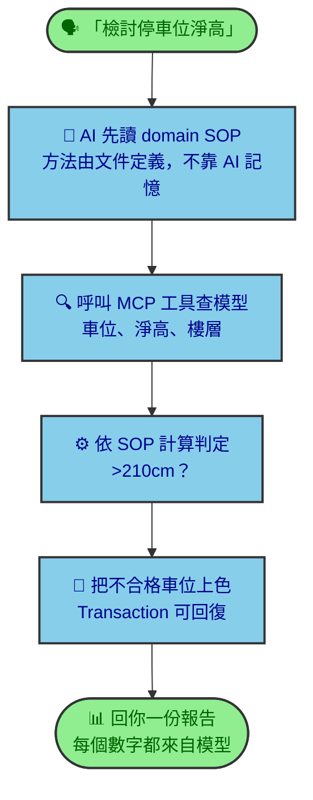
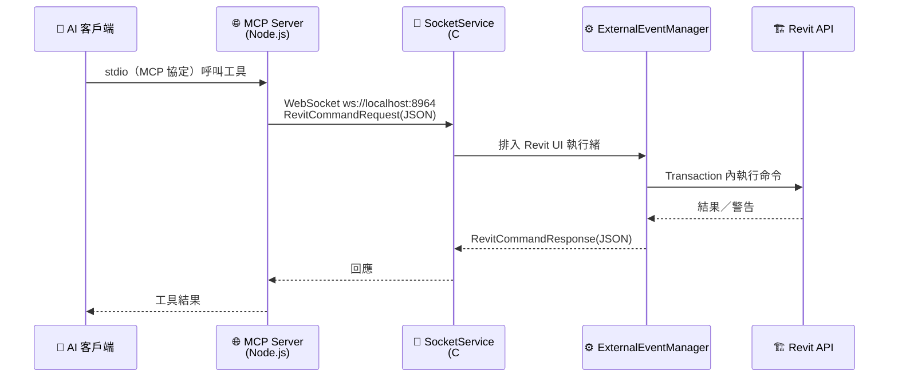
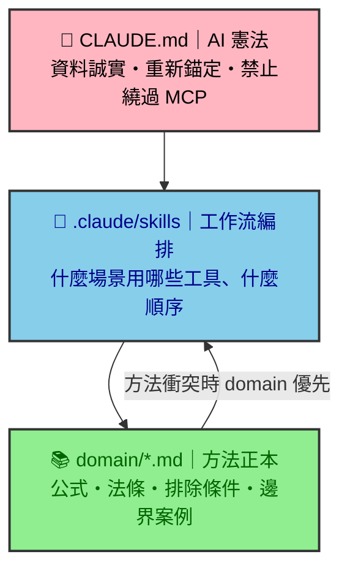
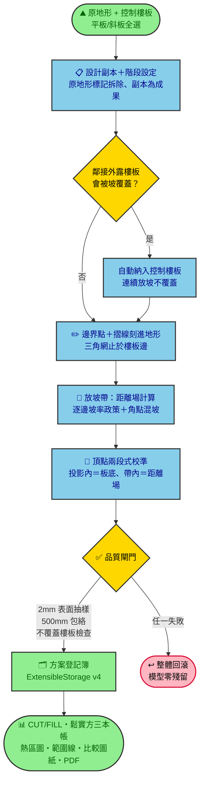

# Revit MCP：用自然語言指揮 Revit 的 BIM 自動化橋樑

> 本文是專案的社群介紹文件：第一段用最簡單的方式說清楚「這個專案在幹嘛」，第二段展開完整技術細節。
> 隨開發持續更新；文中數量為 **2026-10-23 快照**，正本以 [`CLAUDE.md`](../CLAUDE.md) 的 Source-of-Truth 計數為準。
> 安裝與上手請看 [`README.md`](../README.md)。

---

## 第一段｜這個專案在幹嘛（3 分鐘版）

**一句話：讓 AI 讀懂你的 Revit 模型，並且動手幫你做 BIM 工作。**

你在 AI 聊天視窗打一句：「幫我檢討這層樓的停車位淨高，不足 210cm 的標紅色」，AI 就會真的去查你打開的 Revit 模型、算出結果、把不合格的車位上色、給你一份報告。中間的橋，就是這個專案。

### 整體架構（簡易版）

### 它會做什麼

| 類別 | 舉例 |
|---|---|
| 📐 建模與修改 | 建牆、樓板、柱、門窗；從 CAD/DWG 圖層批次建柱；批次改參數 |
| 📋 法規檢討 | 居室採光、停車位淨高、排煙窗有效面積、樓梯淨高、外牆開口距離 |
| 🔍 查詢與視覺化 | 依參數篩選元素、依條件上色、MEP 與結構碰撞偵測與著色 |
| 🗂️ 圖面管理 | 批次建圖紙、自動修圖號、從屬視圖網格裁剪、批次匯 PDF |
| ⛰️ 整地土方 | 依樓板整地形、三種放坡模式、挖填方計算書、方案比較出圖（見第二段詳解） |
| 🎥 走動展示 | 在 Revit 排相機站點，一鍵匯出逐格影格、平面／剖面（像素對位）與 glTF，打包成離線四視窗連動網頁 |

規模快照（2026-10-23）：**137 個 MCP 工具**、**52 份 BIM 工作方法（domain SOP）**、**24 個 Claude skills**，支援 Revit 2022–2026。

新增設計選項盤點與幾何匯出、具相機座標的命名 3D 視圖匯出，以及 opt-in 自動啟動、文件開關與連結查詢／重新載入工具；完整工具數以 `MCP_PROFILE=full` 的 `MCP-Server/src/tools/revit-tools.ts` 註冊結果為準。

### 一次對話發生什麼事（簡易流程）

### 三個設計底線

1. **資料誠實**：AI 回答裡的每個 ID、面積、數量都必須來自「這一輪」的工具查詢，不准憑記憶編。
2. **方法有正本**：法規檢討、土方計算這類專業方法寫在 `domain/*.md`（人和 AI 都讀得懂的中文 SOP），AI 照文件做，不自由發揮。
3. **可回復**：所有模型修改都包在 Revit Transaction 裡，做錯了 Ctrl+Z 救得回來。

---

## 第二段｜完整技術細節

### 2.1 系統架構與訊息流

關鍵設計：

- **單一連線**：Revit 端一次只接一個 MCP 連線，新連線會取代舊的——多個 AI 客戶端用「切換」not「並行」。
- **UI 執行緒安全**：所有 Revit API 呼叫經 `ExternalEventManager` 排上 Revit UI 執行緒，WebSocket 執行緒永不直接碰模型。
- **警告自動消化**：`IFailuresPreprocessor` 攔截交易警告（如元素重疊），不彈模態視窗卡住流程，被消化的警告誠實列入回應。
- **跨版本**：單一 `RevitMCP.csproj` 以 Nice3point SDK 出 R22–R26 五個組態；`RevitCompatibility.cs` 抹平 `ElementId` 等 API 差異。

### 2.2 程式碼地圖

| 元件 | 位置 | 職責 |
|---|---|---|
| MCP 工具層 | `MCP-Server/src/tools/*.ts` | 工具定義（snake_case）、參數 schema、`MCP_PROFILE` 過濾（full/architect/mep/structural/fire-safety） |
| 傳輸層 | `MCP-Server/src/socket.ts`、`MCP/Core/SocketService.cs` | stdio ↔ WebSocket 橋接 |
| 命令分派 | `MCP/Core/CommandExecutor*.cs` | 依工作領域拆分的 partial class dispatcher |
| 純幾何層 | `MCP/Core/Grading/*.cs` 等 | 無 Revit API 相依的演算法（可單元測試） |
| 知識層 | `domain/*.md` | BIM 方法正本（中文/雙語），AI 與人共用 |
| 編排層 | `.claude/skills/*/SKILL.md` | AI 工作流程與工具序列指引 |
| 憲法 | `CLAUDE.md` | AI 行為規則、資料誠實條款、計數正本 |

### 2.3 三層知識架構（為什麼 AI 不會亂做）

AI 的一次專業工作 = 憲法管行為 → skill 管流程 → domain 管方法。三者都是版本控制下的文字檔，可以被審查、被 PR、被回溯。

### 2.4 深入案例：整地土方模組（2026-06〜07 開發重點）

最能代表本專案工程方法的模組。輸入「一片地形＋你要整的樓板（平板、斜板都行）」，輸出「設計地形＋完整土方帳＋比較圖說」。

模組亮點：

- **三種整地模式**：`footprint_only`（投影直貼）、`offset_transition`（外延漸變）、`slope_transition`（指定坡度放坡）。
- **逐邊坡率政策**：在 Revit 裡點選樓板的某條邊、指定例外坡率（例：臨路長邊做 1:12 無障礙緩坡），政策存在樓板的 ExtensibleStorage、放坡時生效、快照進登記簿。
- **樓板不覆蓋三層防線**：會被覆蓋的外露鄰接樓板自動納入連續放坡 → 幾何衝突時退回壓蓋保護 → 最後防線覆蓋告警。地下室板（本來就埋著）不受影響。
- **平衡高程反求**：二分法試算樓板統一升降量，逼近挖填平衡（每次試算完整跑整地管線後回滾、不留痕）。
- **方案登記簿**：每個方案的參數、土方量、鬆實方三本帳、邊坡率快照、視圖與截圖路徑，全部存在設計地形的 ExtensibleStorage（v4 schema），跨存檔重開存活，支援多方案並存比較。
- **量測而非重建**：範圍線＝比對「原地形 vs 設計地形」差異場的等值輪廓（封閉、不自交、多板聯集自動正確）；土方正式值一律取 Revit 內建 CUT/FILL，方格法計算書並列差額誠實揭露。
- **表現與送審**：挖填熱區、水保六級坡熱區（AVF）、標高標註、C-00c 單張 A0 總比較圖紙（3D／坡度／剖面／剖透／明細表，一欄一方案）、一鍵批次出 PDF。

### 2.5 品質工程

| 機制 | 內容 |
|---|---|
| 純幾何 TDD | 演算法抽成無 Revit 相依的純函式（距離場、坡率場、輪廓萃取、平衡求解…），NUnit 先紅後綠；2026-07-08 快照 147 例全綠 |
| 執行期閘門 | 整地 2mm 表面抽樣、500mm 銜接帶包絡、樓板覆蓋檢查——過不了就整體回滾 |
| 誠實條款 | 近似值標示（如擾動面積 `IsApproximate`）、被消化的 Revit 警告列入回應、方格法與正式值差額並列 |
| 多版本建置 | R22–R26 五組態；R23 綠燈同時驗證 `#if REVIT2024_OR_GREATER` 守衛正確 |
| 儲存庫 QA/QC | `scripts/verify-qaqc.ps1`：工具計數對齊、文件連結、路徑健檢、mojibake 檢查 |
| 開發日誌 | `log/YYYY-MM.md` append-only，每筆 AI driven 變更含檔案清單與驗證證據 |

### 2.6 如何開始

1. 安裝與設定：見 [`README.md`](../README.md)（中文）／[`README.en.md`](../README.en.md)（English）。
2. 第一次連線排錯：[`docs/troubleshoot-first-install.md`](troubleshoot-first-install.md)。
3. 想貢獻方法：讀 [`domain/README.md`](../domain/README.md) 與 [`CONTRIBUTING.md`](../CONTRIBUTING.md)。

---

## 更新紀錄

| 日期 | 摘要 |
|---|---|
| 2026-07-08 | 初版：整體架構＋整地模組深入案例（V3 逐邊坡率、不覆蓋樓板、範圍線差異場重寫） |

> 維護約定：功能、工具數、架構有變動時同步更新本文（正本計數見 `CLAUDE.md`）。
