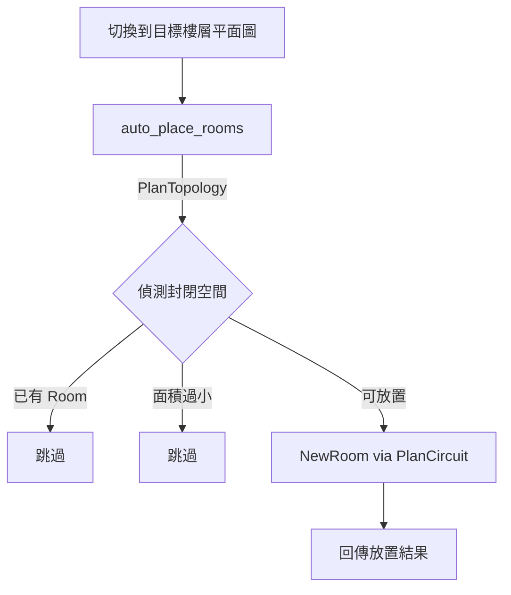

# 自動放置房間

## 概述

使用 Revit 的 `PlanTopology` API 自動偵測指定樓層的所有封閉空間（PlanCircuit），並在未佔用的區域放置 Room 元素。適用於新建專案初期需要快速建立房間配置的場景。

## 所需 MCP 工具

### `auto_place_rooms`

自動偵測封閉空間並放置 Room。

**參數**：
- `levelName`（選填）— 目標樓層名稱，不指定則使用目前平面圖視圖的樓層
- `skipExisting`（預設 true）— 是否跳過已有 Room 的封閉空間
- `minArea`（預設 0.5）— 最小面積門檻（m²），過濾極小空間（如牆體交接處的縫隙）

**回傳**：
```json
{
  "Level": "1F",
  "TotalCircuitsFound": 12,
  "SkippedAlreadyHasRoom": 3,
  "SkippedTooSmall": 2,
  "RoomsPlaced": 7,
  "PlacedRooms": [
    { "ElementId": 123456, "Number": "1", "Area": 25.5, "CenterX": 5000, "CenterY": 3000 }
  ]
}
```

## 資料流



## 執行步驟

### 步驟 1：切換到目標樓層
確保目前視圖為目標樓層的**平面圖**（FloorPlan）。

### 步驟 2：執行自動放置
呼叫 `auto_place_rooms`，可選指定 `minArea` 過濾極小空間。

### 步驟 3：確認結果
使用 `get_rooms_by_level` 查看放置後的房間清單，再用 `get_room_info` 檢視個別房間細節。

### 步驟 4（選填）：命名房間
使用 `modify_element_parameter` 為房間設定名稱：
- `parameterName`: `"名稱"` 或 `"Name"`（依語系而定）
- `value`: 房間用途名稱

## 前置條件

1. **Room Bounding 屬性**：牆體的「Room Bounding」參數需為 `true`（Revit 預設值）
2. **封閉空間**：牆體需完整封閉，有缺口會導致偵測不到
3. **平面圖視圖**：必須在平面圖視圖下執行，立面/3D 視圖無法使用

## 注意事項

1. **PlanTopology 限制**：僅偵測由 Room Bounding 元素（牆、柱、分隔線）圍成的封閉區域
2. **Phase 相關**：Room 會放在目前視圖的 Phase 中
3. **極小空間過濾**：預設過濾 < 0.5m² 的空間，避免在牆體交角處產生不必要的 Room
4. **不可逆操作**：放置後可用 `delete_element` 逐一刪除，但無批次撤銷

## 相關工具

| 工具 | 用途 |
|------|------|
| `get_active_view` | 確認目前視圖和樓層 |
| `get_rooms_by_level` | 查看放置結果 |
| `get_room_info` | 查看個別房間細節 |
| `modify_element_parameter` | 為房間命名 |
| `delete_element` | 刪除不需要的房間 |
