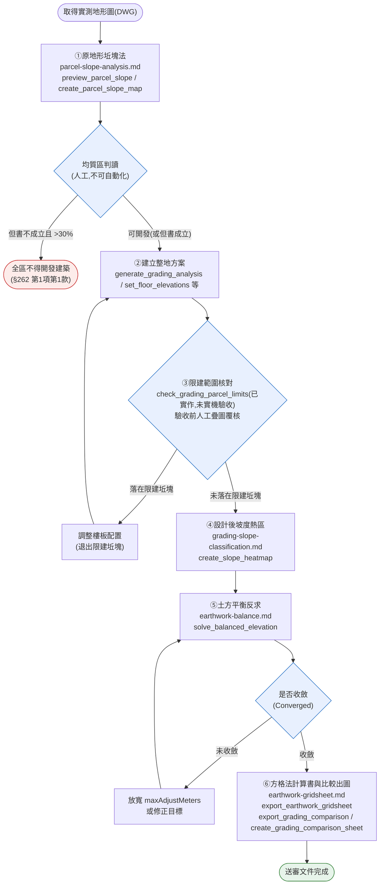

# 山坡地基地檢討總流程（Hillside Site Review SOP）

## 1. 目的與觸發情境

這份文件不新增任何法規知識或演算法——那些已分別寫在四份子 domain 裡。
它要解決的是：**四份子 domain 各自完整，但沒有人說過「先做哪個、再做哪個、中間傳什麼」。**

適用情境：

- 使用者拿到一塊山坡地基地，要走完「原地形限建判定 → 整地方案 → 土方計算書」整套送審流程。
- 使用者或同事問「坵塊法跟坡度熱區是不是同一件事」「這個案子現在卡在哪一步」。
- AI 被要求做山坡地相關任務，需要知道該先讀哪份子 domain、該呼叫哪個工具，而不是憑一般知識亂猜順序。

**本文件不是第五份獨立知識，是四份子 domain 的目錄與交通規則。** 法規數值、公式、工具參數細節一律看子 domain；本文件只講順序與交接。

## 2. 最容易搞混的一件事：兩套「坡度」分工對照表

這是整套流程裡最常被誤用的地方——**兩個工具都叫「坡度」，但回答完全不同的問題，數字不會一樣，不能互相取代**。完整原文見 `parcel-slope-analysis.md` §1 與 §2.1 的分工表；這裡只做總覽對照：

| | **坵塊法**（原地形限建判定） | **坡度熱區／六級坡**（設計後視覺化） |
|---|---|---|
| 算的對象 | **原地形**（整地前的實測地形） | **設計後地形**（整地後的 Toposolid） |
| 輸入來源 | DWG 圖層等高線 | Toposolid 設計地形頂面 |
| 演算法 | 數等高線與坵塊四邊交點數 n，代入 `S(%)=nπh/8L×100`（π 取 3.14） | 設計面法向量 `slope%=100×√(nx²+ny²)/nz` |
| 法源 | 建築技術規則建築設計施工編 §261（算法）、§262（法律效果） | 水土保持技術規範 §23（六級坡級距）；宜林地屬性另見山坡地土地可利用限度分類標準 §4 |
| 回答的問題 | 這塊地能不能開發？哪些範圍不得計入法定空地？ | 整地完的地形坡度分布看起來怎樣？哪裡陡、哪裡緩？ |
| 對應工具 | `preview_parcel_slope`、`create_parcel_slope_map`、`get_parcel_contour_layers` | `create_slope_heatmap` |
| 法律拘束力 | **有**（§262 不得開發建築／不得計入法定空地／限空地不得配置建築物） | **無**（純視覺化定位，§262 這類終局判定不得用熱區圖代替） |

⚠️ **不可互相取代**：送審用坵塊法產出的坵塊圖；坡度熱區圖只能輔助設計階段判讀整地後地形，**不得**拿熱區圖充當坵塊圖送審（`parcel-slope-analysis.md` §7 禁止事項第5項）。兩者數字本來就會不一樣——一個算原地形、一個算設計後地形，不是誤差也不是誰算錯。

## 3. 總流程六階段

### ① 原地形坵塊法 → 限建坵塊與不計入法定空地坵塊

- **目的**：在實測地形圖上劃坵塊、求各格平均坡度，依 §262 標出「超過 30%」（限空地或不得開發，視均質區但書）與「超過 55%」（不得計入法定空地）的坵塊。
- **讀哪份子 domain**：`parcel-slope-analysis.md`（全文，尤其 §4 均質區劃分不可自動化、§6 等高線來源限制）。
- **用哪些工具**：`get_parcel_contour_layers`（先辨認哪一層是等高線）→ `preview_parcel_slope`（只算不畫，確認參數合理）→ `create_parcel_slope_map`（正式繪圖產出坵塊圖）。
- **產出**：坵塊圖（每格編號、交點數 n、平均坡度 S%、§262 分級標示）。
- **交給下一階段**：逐格坡度數值 + 建築師判讀後的均質區劃分結果（工具不自動產出，見下方常見錯誤）。
- **常見錯誤**：
  - 把工具輸出的逐格坡度直接當終局結論（「這塊地不得開發」）——均質區劃分與但書適用**必須由建築師判斷**，工具禁止自動輸出此類結論（`parcel-slope-analysis.md` §4）。
  - 把坵塊邊長 L 誤用成四邊交點總和而非單邊長度，坡度會低估至 1/4（`parcel-slope-analysis.md` §2.1）。

### ② 建立整地方案

- **目的**：依①判讀出的限建範圍，設計控制樓板配置與整地方式（直貼／外延漸變／指定坡度放坡），落成方案登記簿。
- **讀哪份子 domain**：本階段屬整地模組本體，不在四份子 domain 範圍內；參考 `docs/superpowers/specs/2026-07-02-toposolid-footprint-cut-fill-design.md`（`earthwork-balance.md` §10、`grading-slope-classification.md` §6 皆指向此檔）。
- **用哪些工具**：`generate_grading_analysis`（備妥方案視覺內容）、`set_floor_elevations`（批次設樓板高程／斜板）、`set_floor_edge_slope`（指定邊坡率政策）、`duplicate_floor_draft`（複製樓板草稿準備下一版方案）、`grade_toposolid_to_floors`（依樓板投影範圍整平地形）、`list_grading_schemes`（查目前已有哪些方案）。
- **產出**：整地方案（控制樓板 + 設計地形 + 方案登記簿記錄）。
- **交給下一階段**：方案的樓板投影範圍與設計地形，供③疊圖核對。
- **常見錯誤**：方案做完才發現樓板落在①標出的限建坵塊上，整地要重來——這正是③要提早攔住的狀況。

### ③ 限建範圍核對：整地方案是否落在限建坵塊上

- **目的**：核對②的樓板配置有沒有落在①標出的「超過 30%」限建坵塊或「超過 55%」不計入法定空地坵塊上。
- **讀哪份子 domain**：`parcel-slope-analysis.md` §5.1（分級標示對照）。
- **用哪些工具**：`check_grading_parcel_limits`——**已實作、尚未在 Revit 實機驗收；驗收前結果須以人工疊圖覆核**（`drawOverlay=true` 會在整地方案 3D 視圖畫出被壓到的限建坵塊外框並標註面積，見 `parcel-slope-analysis.md` §8）。人工覆核做法：把①的坵塊圖與②的樓板投影範圍疊在同一張平面視圖目視核對，或用 `show_grading_terrain` 顯示方案地形後肉眼比對坵塊圖套疊。
- **產出**：核對結論（通過 / 需調整樓板）。回應若帶 `warnings`（例如樓板超出坵塊網格涵蓋範圍、樓板有內孔未扣除、樓板輪廓取不到、或文件上已有過期疊圖），必須逐條轉述給使用者，不得只報面積數字。
- **交給下一階段**：確認樓板不落在限建坵塊上的方案，才進入④。
- **常見錯誤**：跳過這一步直接做④⑤⑥，結果整套出圖做完才發現②的方案違反①的限建範圍，前面工作白做。

### ④ 設計後坡度熱區

- **目的**：對②（通過③核對）的設計後地形做坡度視覺化，供設計階段判讀陡緩分布，非法定終局判定（見第 2 節分工表）。
- **讀哪份子 domain**：`grading-slope-classification.md`（全文，尤其 §2.1 宜林地屬性限制——只有六級坡可標宜林地，禁止出現「加強保育地」字樣）。
- **用哪些工具**：`create_slope_heatmap`。
- **產出**：坡度熱區圖（AVF 著色，一級坡綠～六級坡紫，圖例列各級範圍與屬性）。
- **交給下一階段**：設計地形供⑤的 CUT/FILL 評估。
- **常見錯誤**：在圖例或報告中把四、五級坡標成「宜林地」或任何級別標「加強保育地」——條文未許可，`SlopeClassifierTests` 已鎖定此禁止（`grading-slope-classification.md` §2.1）。

### ⑤ 土方平衡反求

- **目的**：在不改變基地輪廓的前提下，反求控制樓板的統一升降量，使淨土方（FILL−CUT）逼近目標值（預設 0＝挖填平衡）。
- **讀哪份子 domain**：`earthwork-balance.md`（全文，尤其 §8 鬆實方三本帳——涉及料源調度或送審土方數量者必須提供鬆實方係數）。
- **用哪些工具**：`solve_balanced_elevation`。
- **產出**：收斂的 offset（或未收斂時的最佳解 + 警告）；`apply=true` 且收斂時寫入樓板並落成新方案。
- **交給下一階段**：最終方案的 CUT/FILL（Revit 正式值），供⑥方格法計算書對帳。
- **常見錯誤**：
  - 未提供 `looseFactor`/`compactionFactor` 就拿 `bank` 基準（自然方）的結果當料源調度依據——未提供係數的結果只供概念階段參考，不得作為調度依據（`earthwork-balance.md` §8「規定」段）。
  - 未收斂（`Converged=false`）仍把結果套用到模型——規則是僅在收斂時套用（`earthwork-balance.md` §7）。

### ⑥ 方格法計算書與比較出圖

- **目的**：把最終整地方案的挖填量以格網矩陣呈現，產出可交付、可人工複核的 Excel 計算書；並產出各方案比較出圖供送審或決策參考。
- **讀哪份子 domain**：`earthwork-gridsheet.md`（全文，尤其 §1 定位——方格法加總是呈現值，不是權威值，正式土方量以 Revit CUT/FILL 為準）。
- **用哪些工具**：
  - 計算書：`export_earthwork_gridsheet`。
  - 比較出圖：`export_grading_comparison`（方案登記簿 Excel 比較表）、`create_grading_comparison_sheet`（C-00c 總比較圖紙）、`create_grading_presentation`（各方案別出圖）、`create_cutfill_heatmap`、`create_grading_extent_lines`、`annotate_grading_scheme`、`create_grading_scheme_view`、`place_views_on_sheet`、`export_sheets_pdf`。
- **產出**：方格法計算書 Excel、方案比較 Excel／PDF、各方案出圖套。
- **交給下一階段**：送審文件組（流程終點）。
- **常見錯誤**：
  - 對外送審或計價引用方格法加總值而非 Revit 正式 CUT/FILL——方格法僅供佐證與複核（`earthwork-gridsheet.md` §7）。
  - 格內有轉折（稜線、坡腳）卻用大格徑硬跑，格中心單點取樣系統性偏離四角平均法（`earthwork-gridsheet.md` §4）。

## 4. 流程圖

依 `domain/domain-flow-visualization.md` 規定，flowchart 一律由 `scripts/mermaid_from_spec.py`（實際路徑 `.claude/skills/domain-diagram/scripts/mermaid_from_spec.py`）由結構化 spec 產生，不手刻 fence。本圖已依該腳本產生並跑過健檢（下方「流程健檢結論」為腳本自動輸出，非手寫）：

### 流程健檢結論（腳本自動 + 人工）

- [項1] **人工確認** — 偵測到迴圈 `s2 → d2 → fix1 → s2`：②整地方案 ↔ ③限建範圍核對的調整迴圈。退出條件是「樓板不再落在限建坵塊上」，由人工疊圖核對判斷，屬有限次數的人工迭代，判定安全。
- [項1] **人工確認** — 偵測到迴圈 `s4 → d3 → fix2 → s4`：⑤土方平衡求解的放寬迴圈。`solve_balanced_elevation` 內部二分法本身有 `maxIterations`（上限 30）防呆（見 `earthwork-balance.md` §4、§6），外層「放寬 `maxAdjustMeters` 再試」由人工決定次數，判定安全。
- [項5] **人工，待補強** — 前置缺口：本流程未定義「①的均質區判讀結論」要以什麼形式記錄並傳遞給②（例如：書面簽認、圖面標註、還是口頭確認）。**未查證，待使用者確認**——目前子 domain 都只說「由建築師判斷」，沒有說判斷結果要怎麼落檔。
- [項6] **人工，待補強** — 原子性：②（整地方案）與⑤（土方平衡 `apply=true`）都會寫入模型並落成新方案登記簿記錄；若⑤執行到一半 Revit 當機，`earthwork-balance.md` §5 已規定試算階段用 `finally RollBack()` 不留痕，但「套用」那次寫入是否同樣有復原機制，**未查證，待使用者確認**。

## 5. 禁止事項與已知限制

1. **不得**拿坡度熱區圖（④）充當坵塊圖（①）送審——兩者算的對象不同，詳見第 2 節與 `parcel-slope-analysis.md` §7 禁止事項第5項。
2. **不得**跳過③（限建範圍核對）直接進入④⑤⑥——③工具 `check_grading_parcel_limits` 已實作但**尚未在 Revit 實機驗收，驗收前結果必須以人工疊圖覆核**，不得以「反正後面會發現」為由省略。
3. **不得**自動輸出①的「可否開發建築」終局結論——均質區劃分與但書適用由建築師判斷，見 `parcel-slope-analysis.md` §4。
4. **不得**在④的圖例或報告中標「加強保育地」，或把四、五級坡標成「宜林地」——見 `grading-slope-classification.md` §2.1。
5. **不得**對外送審或計價引用⑥方格法的加總值——正式土方量以 Revit CUT/FILL（登記簿）為準，見 `earthwork-gridsheet.md` §1、§7。
6. **已知限制**：坵塊法（①）**尚未在 Revit 實機完整驗收**——`parcel-slope-analysis.md` 本身未聲明已通過實機測試，本文件沿用子 domain 現狀，不自行宣稱已驗收。
7. **已知限制**：四份子 domain 的法規查證日為 **2026-09-21**（`parcel-slope-analysis.md`、`grading-slope-classification.md` metadata）。**送審前須複核現行條文版本**，法規可能在查證日後修正；本文件與子 domain 皆不自動追蹤法規異動。
8. **已知限制**：`check_grading_parcel_limits` 已實作但尚未在 Revit 實機驗收（見 `parcel-slope-analysis.md` §8）；驗收前③的核對結果仍須以人工疊圖覆核，不得單憑工具輸出下結論。

## 6. 相關

- 原地形限建判定（坵塊法）：`parcel-slope-analysis.md`
- 設計後坡度視覺化（六級坡）：`grading-slope-classification.md`
- 土方平衡反求：`earthwork-balance.md`
- 方格法土方計算書：`earthwork-gridsheet.md`
- 流程圖產生方法：`domain-flow-visualization.md`
